# email-security-lab

Email security is vital for making sure emails are coming from the right place and good senders based off secure settings. SPF makes sure which mail servers are authorized, DKIM adds a signature so that systems can validate the domain's public key, while DMARC makes sure both are aligned and specifies how each one should handle failures and reporting. 

# Setup
After setting up a Microsoft 365 domain, go to Settings -> Domains and get here:    
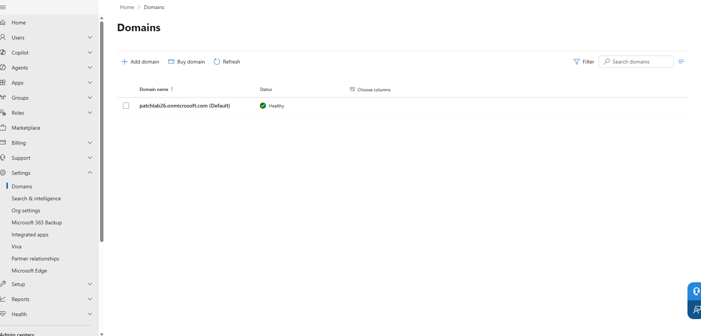  
And you will be greeted by the add a domain screen, so I'll put jon-myemaillab and click on use this domain:    
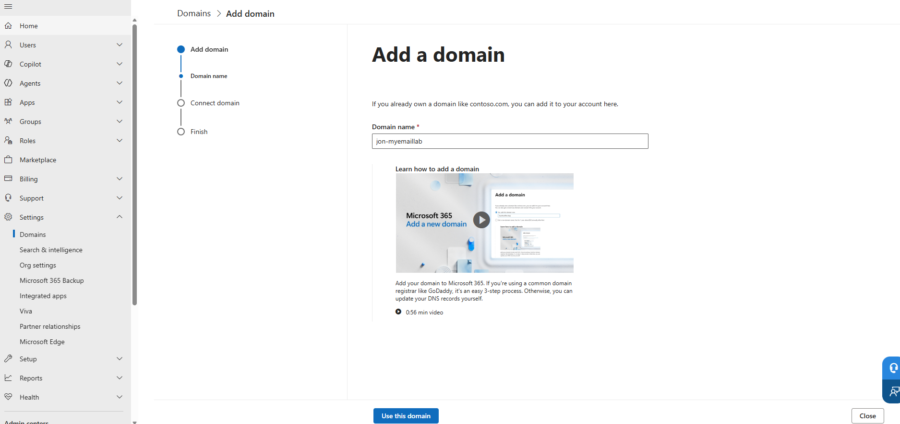    
And make sure to add a .com at the end and click on use this domain. Then on the next screen:   
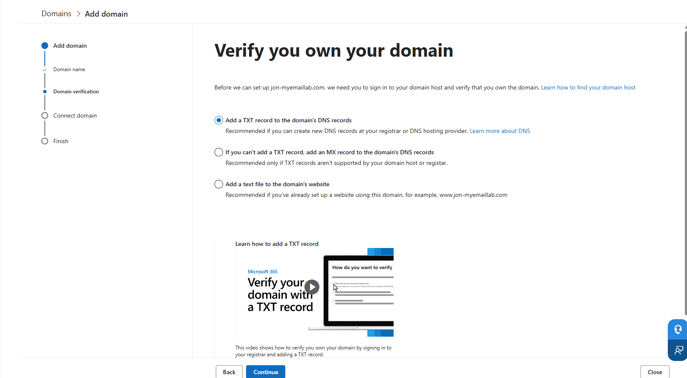  
Click on the first option for adding a .TXT option and reach the add a record to verify ownership screen and save the TXT name, value and TTL for freeDNS.  
Then go to freeDNS here: https://freedns.afraid.org/menu/   
And click on subdomains -> Add a Subdomain and get here:    
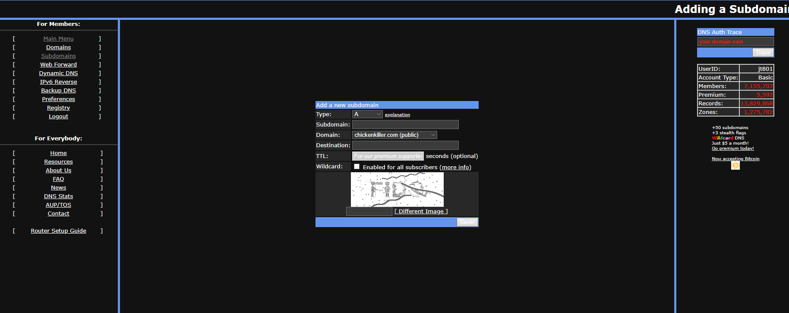  
Change the type to text, enter in the subdomain details and change the domain, enter the destination as the MS value in "" and enter the codes but I usually reach this:    
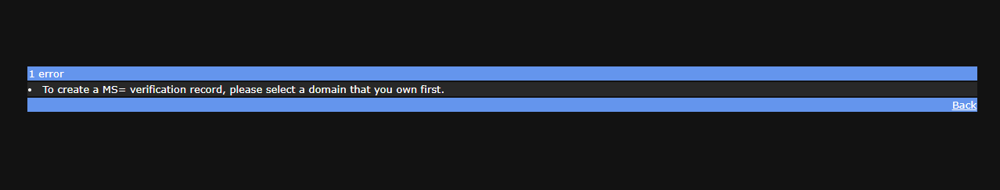  
So lets go buy a domain from Cloudflare and look for a .com or .org and buy it. After buying, click on manage and go to DNS records/configurations to verify:   
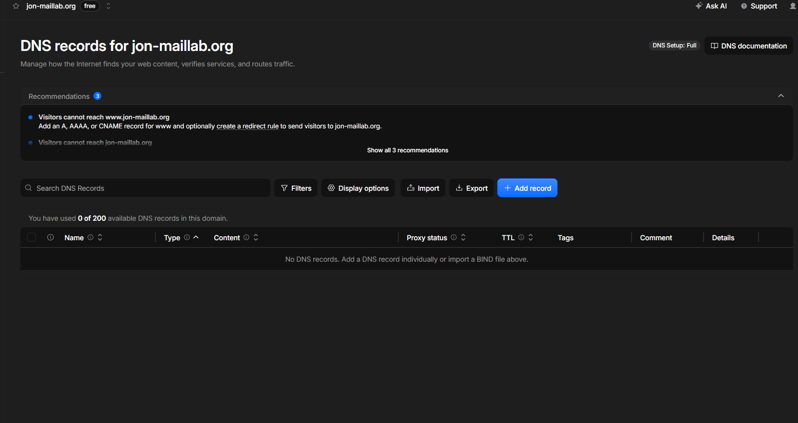    
Then go back to Settings -> Domains in 365 and click on add domain and enter the domain that was bought and get here:   
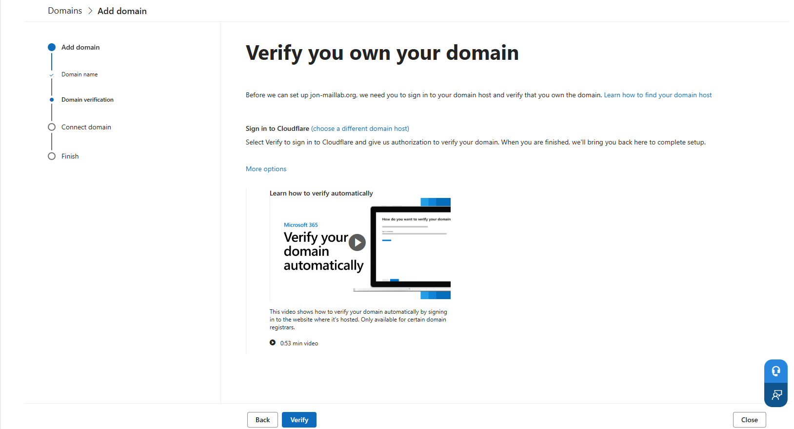 
Since it detects cloudflare the auto method is available but lets click on different options to add a TXT record and hit continue and reach the add a record to verify ownership screen and copy it and go to Cloudflare and click on add record.   
In add record, set the type to TXT, for name type @, and for content put the MS=text that was generated and click on save. 
Then in a command prompt type nslookup -type=TXT jon-maillab.org to see the MS pop up.  
Then go back to 365 and click on verify:    
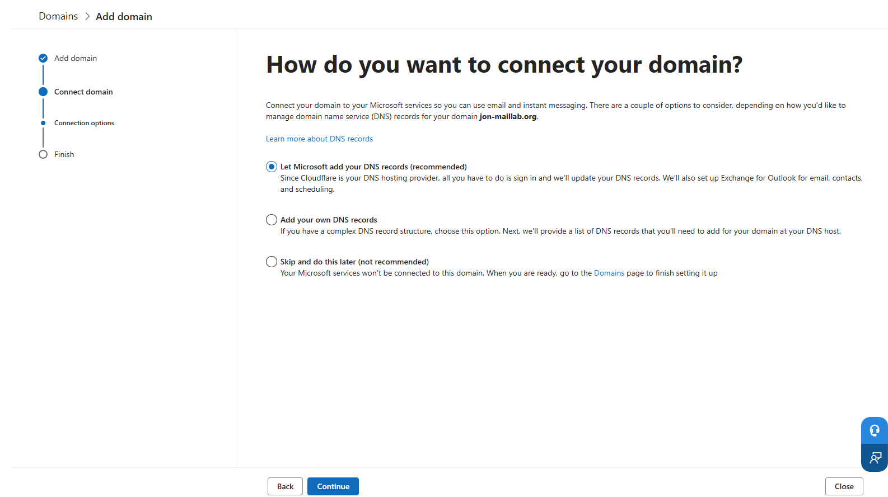    
Choose the Add your own DNS option and get to the Add DNS records screen and since I don't have the Business Basic Standard trial I'll have to get the trial for it to use Exchange so hit continue and add. Shortly after doing this I got the trial. Then assign the license to the admin user and create 2 users with the domain bought and the licenses.    
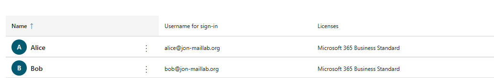    
And with license added, go back to Settings -> Domains and click on the Cloudflare domain and when doing adding the DNS option, the Exchange information will pop up and finish the setup for it and it should say healthy. 
Then in Cloudflare for DNS, add several DNS records for information that was created for Exchange and enter it into Cloudflare with the first one as an MX with the MS valeu, second as a TXT with the v=spf info, third as CNAME with it named autodiscover with the content of autodiscover.outlook.com, and the fourth one named as _dmarc with the content having v=DMARC1; p=none rua=mailto:alice@jonmaillab.org; fo=1 and then do nslookups on them all to verify by typing: 
nslookup -type-MX jon-maillab.org 1.1.1.1   
nslookup -type=TXT jon-maillab.org 1.1.1.1
nslookup -type=TXT _dmarc.jon-maillab.org 1.1.1.1   
nslookup -type-MX jon-maillab.org 1.1.1.1   
nslookup -type=CNAME autodiscover.jon-maillab.org 1.1.1.1   
Then go to one of the user accounts, create a password for it, then sign into it, set up MFA and get into email like so:    
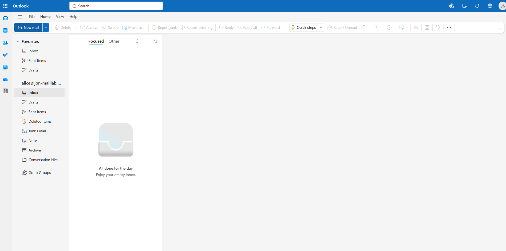    
Then I'll send a test message to my email and get it to send to myself. After sending:  
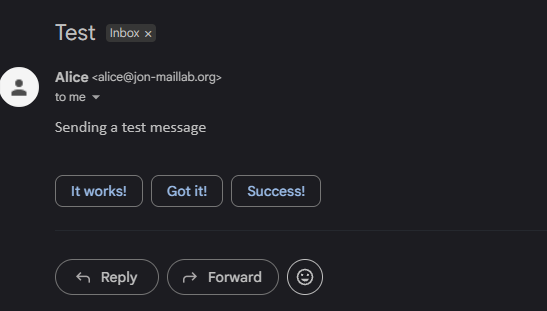  
Then in Gmail, click on the three dots in the right corner and click on show original.  
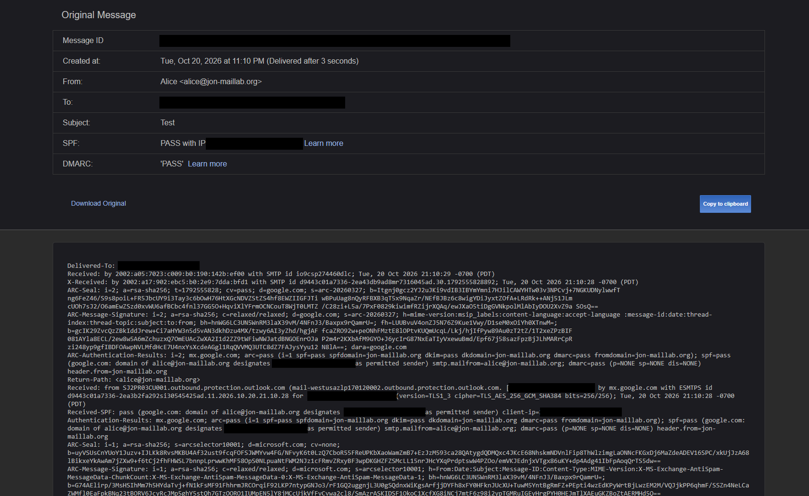   
Then I sent a reply to Alice by saying hello i think and the report came a few hours later: 
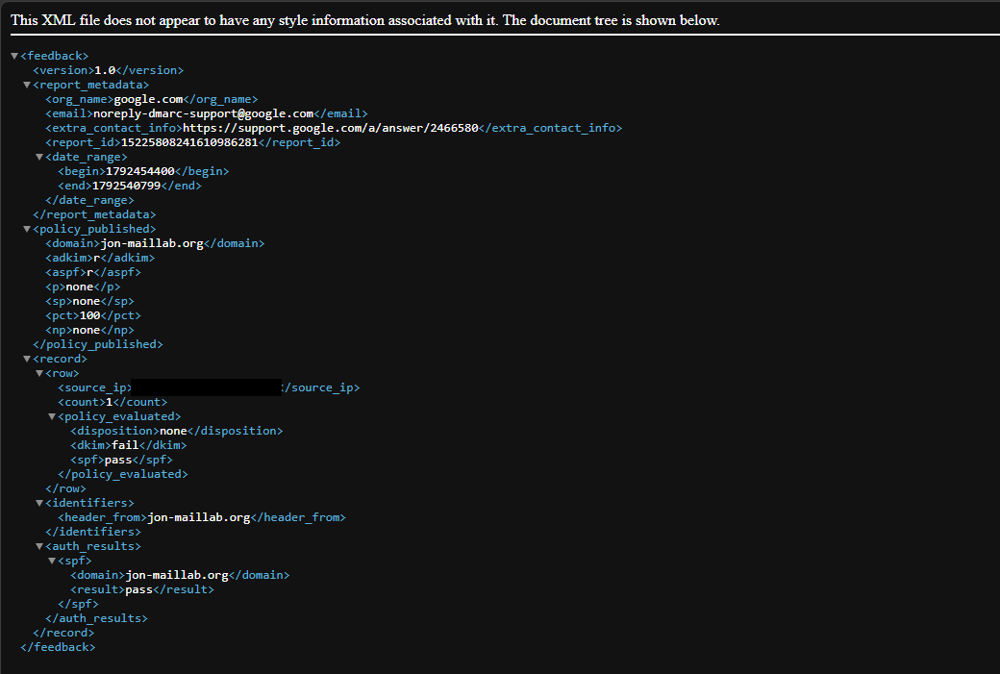 
And this can also be seen in the dmarc report section. From looking over it seems that a few edits must be made since DKIM shows as failed since SPF and DMARC passed with no DKIM signature yet. So go to Microsoft Defender -> Email & Collaboration -> Policies & rules -> Threat Policies -> Email Authentication settings -> DKIM and see that it faild to load. Did some troubleshooting and what occured with Claude: 
1. Environment
Item	Choice
Domain	jon-maillab.org (registered at Cloudflare Registrar)
DNS host	Cloudflare (free plan), all mail records set to DNS only
Mail platform	Microsoft 365 Business Standard trial (Exchange Online)
Test mailboxes	alice@ and bob@jon-maillab.org, plus an external Gmail account

Setup problems I hit (and what I did)

Free domain failed. FreeDNS blocks MS= verification records on its shared public domains, and the record that saved had lost its MS= prefix. I confirmed this from the error message and the mismatch between what I entered and what was stored, then switched to a registered domain.
No Exchange license. The "Add DNS records" step had no Exchange option. The leftover trial only had Entra ID P2 and Intune, neither of which includes a mailbox. I added Business Standard and assigned licenses to both users.
2. DNS records
nslookup -type=TXT jon-maillab.org 1.1.1.1  
nslookup -type=MX jon-maillab.org 1.1.1.1   
nslookup -type=TXT _dmarc.jon-maillab.org 1.1.1.1   
nslookup -type=CNAME autodiscover.jon-maillab.org 1.1.1.1   
Type	Name	Value
TXT	@	MS=ms######## (domain verification) 
MX	@	jon-maillab-org.mail.protection.outlook.com, priority 0 
TXT	@	v=spf1 include:spf.protection.outlook.com -all  
CNAME	autodiscover	autodiscover.outlook.com    
TXT	_dmarc	v=DMARC1; p=none; rua=mailto:alice@jon-maillab.org; fo=1    

DMARC starts at p=none (monitor only) so I could collect reports before enforcing.  

3. Baseline test (before DKIM)

I sent a message from Alice to Gmail and read the header under Show original.   
Which shows here or just scroll above:  
    
The SPF and DMARC both pass with no DKIM signature. 
A correction worth noting: I first read this header as "DKIM passes", because an ARC-Authentication-Results line contained dkim=pass. That line is Microsoft's own evaluation at its hop, preserved by ARC. It is not Google's check of a DKIM signature. The DMARC report below showed dkim=fail, which I cross-checked against the header to find the mistake. Lesson: use the receiving server's own Authentication-Results line, and confirm with a second source.  

4. First DMARC aggregate report (Google)

A report arrived about a few hours after the first test messages. Which can be seen by scrolling up or here:    
 
Field	Value	Meaning
Reporter	google.com	Receiving provider
Window	2026-10-20 00:00 to 23:59 UTC	24-hour period
Published policy	p=none, sp=none, pct=100, relaxed alignment	What Google saw in _dmarc
Source	Microsoft outbound IPv6 (redacted)	Sending server
Count	1	Messages from that source
Disposition	none	No action at p=none
DKIM / SPF	fail / pass	Aligned results used for DMARC

DMARC needs either SPF or DKIM to pass and align, so one pass is enough. That is also the weakness here. Forwarding breaks SPF, which would leave the domain with no passing mechanism. DKIM needed to be enabled.

5. Enabling DKIM

The Defender portal DKIM page (Email & collaboration, Policies & rules, Threat policies, Email authentication settings, DKIM) returned "Failed to load data", including in a private window. Accepted domains in the Exchange admin center showed jon-maillab.org as authoritative, so Exchange itself was healthy. I configured DKIM through Exchange Online PowerShell instead.   
Connect

powershell
Install-Module ExchangeOnlineManagement -Scope CurrentUser
Set-ExecutionPolicy RemoteSigned -Scope CurrentUser    # module failed to load until this was set
Import-Module ExchangeOnlineManagement
Connect-ExchangeOnline -UserPrincipalName ADMIN@<tenant>.onmicrosoft.com

Check for an existing config. It returned "object couldn't be found", so no DKIM config existed for the domain.

powershell
Get-DkimSigningConfig -Identity jon-maillab.org | Format-List Domain,Enabled,Selector1CNAME,Selector2CNAME

Create the config (disabled) and read the selector targets

powershell
New-DkimSigningConfig -DomainName jon-maillab.org -Enabled $false
Get-DkimSigningConfig -Identity jon-maillab.org | Format-List Selector1CNAME,Selector2CNAME

Publish two CNAMEs in Cloudflare (DNS only)

Name	Target
selector1._domainkey	value of Selector1CNAME
selector2._domainkey	value of Selector2CNAME
nslookup -type=CNAME selector1._domainkey.jon-maillab.org 1.1.1.1
nslookup -type=CNAME selector2._domainkey.jon-maillab.org 1.1.1.1

Current targets end in .dkim.mail.microsoft. Older documentation shows .onmicrosoft.com, so always copy the values from Get-DkimSigningConfig.

Enable signing, retrying while Microsoft syncs

powershell
1..12 | ForEach-Object {
  try {
    Set-DkimSigningConfig -Identity jon-maillab.org -Enabled $true -ErrorAction Stop
    Write-Host "Enabled"; break
  } catch {
    Write-Host "Not yet ($_)"; Start-Sleep -Seconds 300
  }
}
Get-DkimSigningConfig -Identity jon-maillab.org | Format-List Domain,Enabled,Status

Result: Enabled : True, Status : Valid.

6. Troubleshooting notes from the DKIM work
Symptom	Root cause	Fix
Connect-ExchangeOnline found the module but could not load it	PowerShell execution policy	Set-ExecutionPolicy RemoteSigned -Scope CurrentUser
DKIM CNAMEs resolved to the literal text selector1cname	I pasted the property name instead of the value from the PowerShell output	Edited both records with the real targets, then re-ran nslookup
Cloudflare rejected the target with "Content for CNAME record is invalid"	The Target field still held the label text Selector1CNAME :	Replaced it with only the value after the colon
Set-DkimSigningConfig failed with "CNAME record does not exist" even though nslookup showed correct records	Microsoft's backend had not synced yet. The error lists the same two records I had published	Waited and retried on a loop. It succeeded on the second attempt, about 5 minutes later

The records were correct from the start of the sync delay. I verified this by comparing the targets in Microsoft's error message against my nslookup output character for character, instead of assuming a DNS fault.   
Then I sent a email from Alice to my again and saw this after clicking on the three dots:   
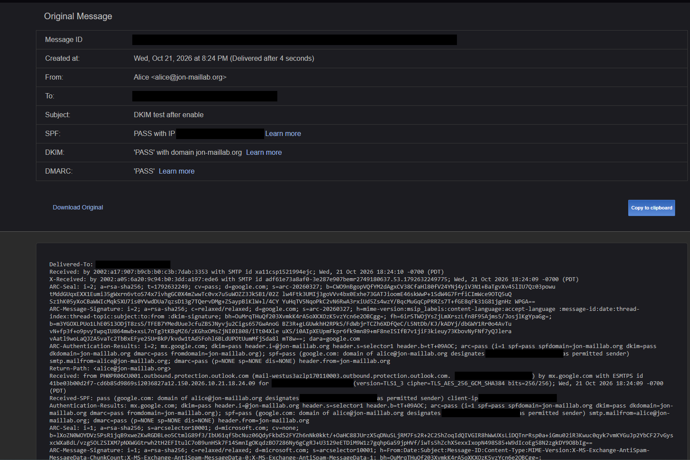  
Now it shows DKIM as working with a PASS for DKIM